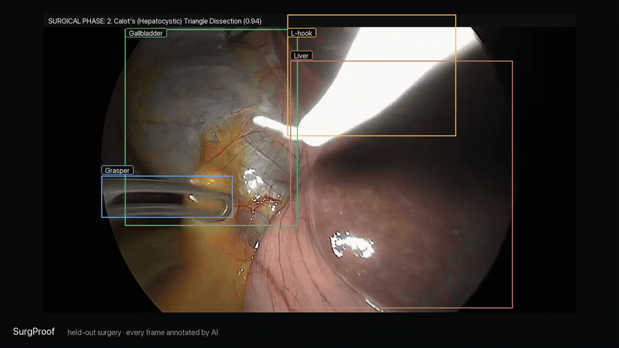
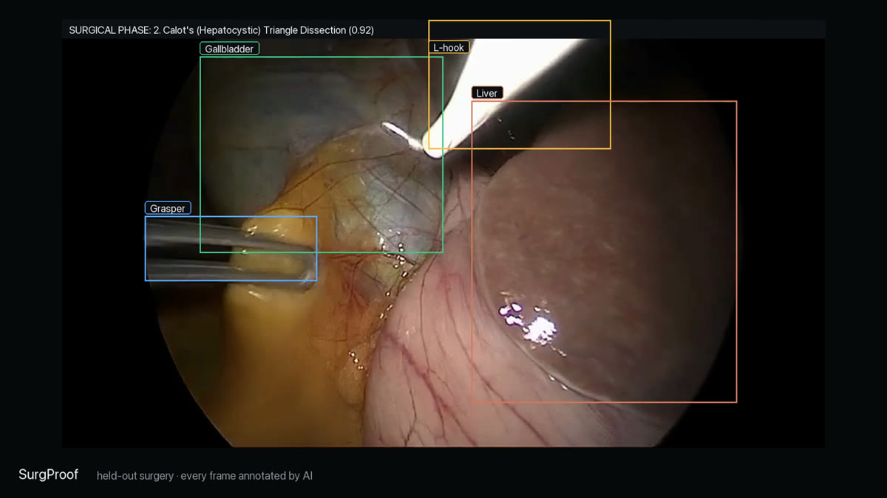
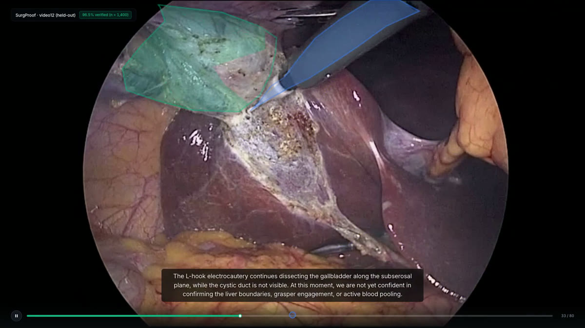
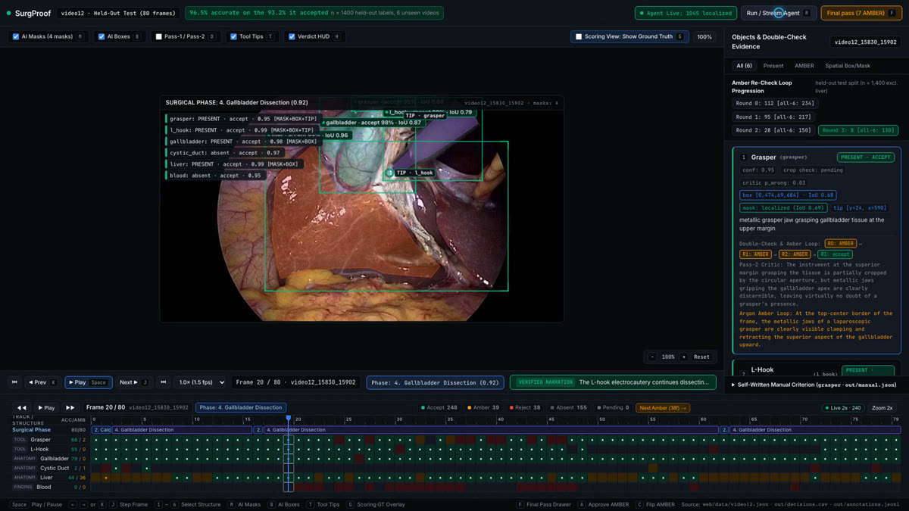
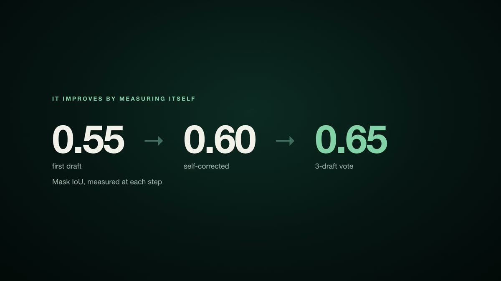
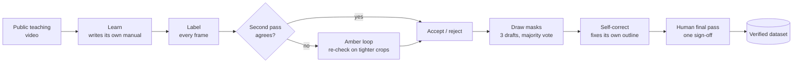

<div align="center">

# SurgProof

### Surgical video in. A verified dataset out. No human labels.



<sub>Held-out surgery the system never saw while being built. Every box drawn by the AI.</sub>

<br/>

[**▶ Watch the 90-second launch film**](https://drive.google.com/open?id=1ldvArksuR78BkvMRAsz706D3X1bA2_KW) &nbsp;·&nbsp; [How it works](docs/WORKFLOW.md) &nbsp;·&nbsp; [Results](#the-proof) &nbsp;·&nbsp; [Run it](#run-it)


</div>

---

## Why this exists

Every surgical AI model is only as good as its labelled data, and that data is made by surgeons drawing on video frame by frame. They don't have the time. The field says so itself:

> *"The major bottleneck for data annotation in surgical applications is access to expert knowledge."*
> Maier-Hein et al., 2022

The best annotation tools today (Supervisely, CVAT, Encord) make labelling faster, but a person still seeds every object, fixes every tracking error and reviews every frame.

**SurgProof takes the person out of the loop and keeps them in charge.** The AI does the labelling, the checking and the correcting. A human signs off once, at the end, before anything is released.

## What it looks like

<table>
<tr>
<td width="50%"><br/><sub><b>Every frame, every structure.</b> Gallbladder, liver, grasper and L-hook, tracked through a held-out clip at 25 fps.</sub></td>
<td width="50%"><br/><sub><b>Watch mode.</b> The AI's masks on the real video, with narration that only says what was verified, and admits what wasn't.</sub></td>
</tr>
<tr>
<td width="50%"><br/><sub><b>The annotation toolbox.</b> Phase, verdicts, a multi-track timeline and the evidence behind every label.</sub></td>
<td width="50%"><br/><sub><b>From the launch film.</b></sub></td>
</tr>
</table>

## How it works



1. **Learn.** Gemini 4 Argon watches a public laparoscopic cholecystectomy teaching video and writes its own manual: what each instrument and organ looks like, with the source cited.
2. **Label.** For every frame: is the grasper there? The L-hook? The gallbladder, cystic duct, blood?
3. **Check itself.** A second, independent pass looks again. Where the two disagree, the label goes amber, and Argon keeps re-examining it on tighter crops until it can decide.
4. **Draw.** Three independent outline drafts per object. A pixel is kept if two of the three agree.
5. **Correct itself.** The model is shown its own outline and asked to fix it. The fix is kept only if two correction passes agree.
6. **Hand over.** A person reviews only what's left unsure, plus a random audit sample, and releases the dataset.

The full write-up is in [docs/WORKFLOW.md](docs/WORKFLOW.md).

## The proof

Everything below is measured on **held-out surgery videos** the system never saw while it was being built. Human ground truth is used only to score the results afterwards; the AI never touches it. Every number was recomputed independently from the raw output files.

<div align="center">

| | |
|:--|:--|
| **96.6%** | accurate on the 93.2% of labels it accepted. n = 1,400 labels from 6 unseen videos, per-video 95% CI 93.6% to 99.4% |
| **99.4 / 99.1 / 95.6%** | presence accuracy when the AI annotates every frame of three held-out clips at 25 fps |
| **0.55 → 0.60** | mask overlap (IoU) with human outlines, first draft → self-corrected (n = 578 masks, all 6 test videos) |

</div>

**We measured our own method and fixed it.** Our first rule for combining mask drafts, keeping only the overlap of two, made masks *worse*, because the AI's outlines tend to under-cover the object. On the calibration split (the only data we tune on), 3-draft majority voting scored IoU 0.69 against 0.56 for the overlap rule, and a union of five drafts reached 0.75. On the full test set, voting scores 0.59 (n = 608), above the first draft, so the next step is combining voting with self-correction.

<details>
<summary><b>How we keep it honest</b></summary>

- `lanes/integrity.py` fails the build if any screen or video shows a hand-typed box, verdict or number; if ground truth leaks into anything the AI reads; if a label can't be traced back to a recorded model response; or if a narrated sentence isn't backed by an accepted label.
- An independent re-labelling audit with a different prompt agreed with the system on 23 of 24 random accepted labels, and the system was right on all 24.
- Results on external datasets (Endoscapes2023, CholecT50) are reported separately and scored only on the structures those datasets actually label.

</details>

<details>
<summary><b>Honest limits</b></summary>

- Six test videos is a small sample; that's why every headline number carries its n and a confidence interval.
- Masks are zero-shot first drafts. Instruments are traced well (L-hook IoU about 0.8); large organs like the liver are harder (about 0.5). The next step is training a small segmentation model on the AI's own verified masks.
- Gemini may have seen public Cholec80 frames during pretraining, which is why external datasets are scored separately.
- Annotating every frame costs about 300 model calls per second of video. Keyframes plus optical-flow propagation cut that tenfold; on one clip, IoU dropped from 0.66 to 0.55.

</details>

## Run it

```bash
git clone https://github.com/nirmathur/surgproof && cd surgproof
make setup                       # Python deps; copies .env.example to .env (add your GEMINI_API_KEY)
python3 -c "from huggingface_hub import hf_hub_download; hf_hub_download('minwoosun/CholecSeg8k','data/CholecSeg8k.zip',repo_type='dataset',local_dir='raw')"
(cd raw && unzip -q data/CholecSeg8k.zip)
python3 web/export.py            # builds the app's data from out/
python3 web/serve.py             # toolbox at http://localhost:8600, Watch mode at /watch.html
```

<details>
<summary><b>Re-run the whole pipeline</b></summary>

`prepare_data.py` → `med_school.py` → `label.py` → `accept.py` → `tools/vote_worker.py` → `tools/refine_worker.py` → `tools/dense_worker.py` → `tools/smooth_dense.py`, then score with `tools/score_dense.py` and `eval/`.

</details>

## Where it goes next

The same loop works on any procedure that has a public teaching video. Next we want Critical View of Safety checks, mask propagation across whole operations, and one-click export to COCO, Supervisely and CVAT, so an AI-made dataset drops straight into the tools surgical teams already use.

## Prior work

SurgAtlas (a large dataset of public surgical videos), SurgVLP, SurgSLOT and Med-Gemini. What's new here is taking the human annotator and checker out of the loop entirely, with every claim traceable to a recorded model response.

---

<sub>Data: CholecSeg8k, Endoscapes2023 and CholecT50 (CC BY-NC-SA 4.0), not redistributed here. Launch film music: "COME" by BOCrew (CC BY 3.0). Code: MIT.</sub>
