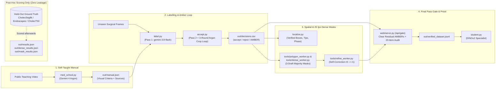

# SurgProof

**An autonomous Gemini 4 Argon surgical video annotation agent that learns a procedure from public teaching video, double-checks and self-corrects its own labels, boxes, tips, and 25 fps masks, and exports a verified dataset with zero human labels.** *(No human labels. Only proof.)*

<!-- VIDEO -->

## Try it in 60 seconds

```bash
make setup
make demo
```

This starts the SurgProof server on <http://localhost:8600> using only the self-contained demo bundle committed in the repository (`web/data/` and `coord/artifacts/`—no API key or external dataset download required):

- **Annotation Toolbox & Final Pass Gate:** <http://localhost:8600/> (or <http://localhost:8600/?present=1> for full-bleed Present Mode)
- **25 fps Watch Mode (every-frame AI masks):** <http://localhost:8600/watch.html> (`?clip=video12_15750`, `?clip=video55_00508`, `?clip=video28_00000`)
- **Test & Integrity Suite:** `make test` and `python3 lanes/integrity.py`

---

## The problem

Surgical AI is starved of expert labels. *"The major bottleneck for data annotation in surgical applications is access to expert knowledge."* (Maier-Hein et al., surgical data science consensus, 2022; quote verified verbatim against the saved source in `docs/research/sources/`). Today's best annotation suites (Supervisely, CVAT, Encord) still require a human to seed every object, fix tracking drift, and review every frame.

## Architecture



1. **Learns the procedure** from public teaching video and writes its own visual manual (`out/manual.json`, with source URLs).
2. **Labels real frames** (presence of instruments and anatomy), then **checks itself**: every label gets an independent second pass. Agreement means `accept` or `reject`; disagreement means `AMBER`, and a 3-round Argon **Amber Loop** re-examines borderline cases on tighter evidence crops (`112 -> 95 -> 28 -> 8` residual AMBERs on test).
3. **Draws spatial annotations and 25 fps masks itself**: bounding boxes, instrument-tip coordinates, surgical phase, and **segmentation masks** traced as polygons using a **3-draft majority vote** (`tools/dense_worker.py`) and iterative visual self-correction (`tools/refine_worker.py`).
4. **Keeps humans in control with one final pass**: a reviewer clears the few remaining AMBERs and signs off a 20-item random audit sample before releasing `out/verified_dataset.jsonl`.

Ground truth is never read by the agent. It is used strictly post-hoc to score held-out videos.

---

## Results (held-out test videos the system never tuned on)

All numbers below are computed directly from the pipeline output files (`out/` and committed mirrors in `web/data/` and `coord/artifacts/`) against held-out ground truth:

| Task / Metric | Result | Sample Size (`n`) | Source File |
|---|---|---|---|
| **Presence labels, after self-check** (5 informative labels, excl. omnipresent liver) | **96.6% accuracy** (`0.9655`, 95% video CI `[93.8%, 99.4%]`) on **93.2% accepted coverage** vs **92.3%** (`0.9229`) raw single pass (**+4.3 pp**; AMBERs shrunk `112 → 95 → 28 → 8`) | `n = 1,400` labels (`1,305` accepted) across 6 unseen CholecSeg8k test videos | [`out/results.json`](coord/artifacts/results.json) (`accepted_excl_liver`) |
| **Presence labels, all 6 classes** (incl. liver) | **96.9% accuracy** (`0.9692`, 95% video CI `[94.5%, 99.5%]`) on **87.0% accepted coverage** vs **93.5%** (`0.9351`) raw single pass | `n = 1,680` labels (`1,462` accepted), 6 test videos | [`out/results.json`](coord/artifacts/results.json) (`accepted_all_6_labels`) |
| **Every-frame 25 fps dense AI masks** (3-draft majority vote, scored per frame vs GT) | **`video12_15750`: 0.64 mean IoU** (99.4% presence acc, `n=315` masks; `l_hook` 0.81, `grasper` 0.67)<br>**`video55_00508`: 0.66 mean IoU** (98.4% presence acc, `n=299` masks; `l_hook` 0.82, `gallbladder` 0.67)<br>**`video28_00000`: 0.69 mean IoU** (94.7% presence acc, `n=76` masks) | `n = 240` consecutive 25 fps frames (`690` scored object masks, `960` presence decisions) across 3 held-out clips | [`out/dense_results.json`](coord/artifacts/dense_results.json) (smoothed: [`out/dense_smooth_results.json`](coord/artifacts/dense_smooth_results.json)) |
| **Bounding boxes & instrument tips** vs ground-truth masks | **0.76 mean box IoU** (`0.84` median; `86.9%` with IoU ≥ 0.50; `l_hook` `0.91`, `grasper` `0.84`); **88.4% tips within 3 px** of tool mask | `n = 268` scored boxes (`257` accepted), `n = 129` tool tips, 6 test videos | [`out/localize_results.json`](coord/artifacts/localize_results.json) |
| **Keyframe AI masks & self-correction progression** | 2-pass intersection R0 `0.548` → R1 crop loop `0.584` → R2 `0.590` → **final refined `0.646` mean IoU** (`0.760` Dice) on accepted masks | `n = 574` accepted masks (`599` total) across 6 test videos | [`out/mask_results.json`](coord/artifacts/mask_results.json) (`per_round_improvement.accepted_test_masks`) |
| **Draft-combination ablation** (calib split tuning rule) | 2-pass intersection `0.563` → single draft `0.660` → **3-vote majority `0.694`** → 5-vote majority `0.712` → 5-draft union `0.750` mean IoU | `n = 60` calib objects (held-out test sample `n = 48` in `vote_experiment.json`: `vote3` `0.711` vs `intersection` `0.574`) | [`out/vote_experiment_calib.json`](coord/artifacts/vote_experiment_calib.json), [`out/vote_experiment.json`](coord/artifacts/vote_experiment.json) |
| **Keyframe stride + optical-flow propagation** | Stride `s=1` (every frame): **`0.660` IoU** (300 calls/s); `s=5`: `0.560` IoU (60 calls/s); `s=10`: `0.553` IoU (30 calls/s) | `n = 80` frames on `video28_00000` | [`out/keyframe_quick_video28_00000.json`](coord/artifacts/keyframe_quick_video28_00000.json) |
| **Specialist DINOv2 student** trained only on self-verified labels | **90.1% test accuracy** (`0.9014`) vs **88.9%** (`0.8893`) trained on raw single-pass labels (**+1.2 pp**; core balanced 3-label F1 `0.848` vs `0.825`) | `n = 280` test frames (6 videos), trained on `n = 630` train frames | [`out/student.json`](coord/artifacts/student.json) |

---

## Integrity & Honest Limits

### Automated Integrity Checker (`lanes/integrity.py`)
`python3 lanes/integrity.py` fails the build (`exit 1`) if:
- Any display file (`app.py`, `narrate.py`, `pages/*.py`, `promo/*.py`, `web/*.js`, `web/*.html`, `web/*.py`) contains hand-typed bounding boxes, literal verdicts, hard-coded metric percentages, or synthetic score formulas.
- Any ground-truth column (`gt_*`, `truth`, `mask_path`) leaks into labeller output or is read inside `accept.py`, `localize.py`, `verify_localize.py`, or `verify/*.py`.
- Any sampled label or decision in `out/labels_*.jsonl` or `out/decisions.csv` cannot be traced to a real recorded Gemini response in `cache.sqlite`.
- Any narration sentence in `out/narration_*.json` cites a non-accepted decision.

### Honest Limits
1. **No human labels in training; upper bounds clearly separated:** No human annotations are used to prompt, verify, or train the system. Results on the `calib` split (`out/vote_experiment_calib.json`) are used strictly for design selection, and `oracle_upper_bound` in `out/student.json` is clearly flagged as an upper bound trained on ground truth.
2. **Sample size (`n = 6` held-out test videos):** While frame-level and label-level counts are large (`1,400` informative presence labels, `599` keyframe masks, `690` dense masks), they cluster within 6 unseen CholecSeg8k videos (`video09`, `video12`, `video17`, `video28`, `video48`, `video55`). All confidence intervals use video-cluster bootstrap resampling.
3. **Pretraining exposure & external datasets:** Because foundation models may have seen public Cholec80 frames during pretraining, we evaluate with the same frozen manual on external benchmarks (`Endoscapes2023` for `gallbladder` and `cystic_duct`; `CholecT50` for `grasper` and `l_hook`), scoring strictly the classes each dataset annotates (`out/student.json`).
4. **Diminishing returns after Round 1 self-correction:** On keyframe masks (`out/mask_results.json`), Round 1 crop refinement improves accepted mask IoU from `0.548` to `0.584`, whereas Round 2 reaches `0.590`. Replacing 2-pass boolean intersection (which erodes boundaries) with 3-draft majority voting (`out/vote_experiment_calib.json`, `out/dense_results.json`) yields a larger single-step improvement.

---

## Full Pipeline Run Order

To re-run the full pipeline from scratch with a Gemini API key:

```bash
cp .env.example .env                 # set GEMINI_API_KEY in .env
make setup
python3 prepare_data.py              # index CholecSeg8k train / calib / test splits
python3 med_school.py                # learn procedure from teaching video -> out/manual.json
python3 label.py                     # Pass 1 labelling -> out/labels_manual.jsonl
python3 accept.py                    # Pass 2 double-check + 3-round Argon Amber Loop -> out/decisions.csv
python3 localize.py                  # boxes, instrument tips & surgical phase -> out/annotations.jsonl
python3 tools/polygon_worker.py      # keyframe polygon masks -> out/masks/
python3 tools/refine_worker.py       # self-correction rounds -> out/masks_r1/, out/masks_r2/
python3 tools/dense_worker.py --clip raw/CholecSeg8k/video12/video12_15750
python3 tools/score_dense.py         # post-hoc dense mask evaluation -> out/dense_results.json
python3 student.py                   # DINOv2 specialist training & evaluation -> out/student.json
python3 web/export.py                # export web bundle -> web/data/
make demo                            # serve studio & 25 fps player on http://localhost:8600
```

## License & Data Attribution

- **Source Code:** [MIT License](LICENSE)
- **Demo Data Bundle (`web/data/`, `coord/artifacts/`):** Derived from **CholecSeg8k** / **Cholec80** under [CC BY-NC-SA 4.0](DATA_LICENSE.md). See [DATA_LICENSE.md](DATA_LICENSE.md) for full citations and license terms.
