# How SurgProof works

**One sentence:** an AI agent turns raw surgical video into a verified, pixel-level dataset by itself, checks its own work at every step, and asks a human only for a single sign-off at the end.

```mermaid
flowchart LR
    A[Public teaching video] --> B[1. Learn<br/>writes its own visual manual]
    B --> C[2. Label<br/>is each structure in this frame?]
    C --> D[3. Double-check<br/>independent second pass]
    D -->|agree| E[accept or reject]
    D -->|disagree| F[AMBER]
    F --> G[4. Amber loop<br/>re-check on tighter crops]
    G --> E
    E --> H[5. Draw<br/>3 independent mask drafts, majority vote]
    H --> I[6. Self-correct<br/>fixes its own outline]
    I --> J[7. Keyframes + propagation<br/>smooth, stable masks over time]
    J --> K[8. Human final pass<br/>leftover ambers + random audit]
    K --> L[(Released dataset<br/>every label traceable)]
```

## The eight steps

| Step | What happens | Who does it |
|---|---|---|
| 1. Learn | Watches a public laparoscopic cholecystectomy teaching video and writes a manual: what each instrument and organ looks like, with source links | Gemini 4 Argon |
| 2. Label | For every frame: is the grasper, L-hook, gallbladder, cystic duct, blood present? | Gemini Flash |
| 3. Double-check | An independent second pass. Agreement means accept or reject; disagreement means **amber** | Gemini |
| 4. Amber loop | Argon re-examines only the amber cases, on tighter crops, round after round | Gemini 4 Argon |
| 5. Draw | Three independent outline drafts per object; a pixel is kept if two of three agree | Gemini |
| 6. Self-correct | The model sees its own outline over the frame and fixes it; kept only if two correction passes agree | Gemini |
| 7. Over time | AI on keyframes, propagation in between, temporal smoothing for clean, stable video | Optical flow + majority |
| 8. Final pass | A human reviews only the leftover ambers plus a random audit sample, then releases the dataset | Human, once |

## How we know it works (ground truth is used only to score, never by the AI)

- **Presence:** 96.6% accurate on the 93.2% of labels it accepted (n = 1,400 held-out labels, 6 unseen videos; 95% CI 93.6 to 99.4%).
- **Every-frame masks** on 3 held-out clips at 25 fps: IoU 0.63 / 0.66 / 0.69 against human masks, presence 99.4 / 99.1 / 95.6%.
- **It improves by measuring itself:** IoU 0.55 (first draft) → 0.60 (self-corrected) → 0.65 (majority vote); voting was chosen on the calibration split, not the test set.
- **Nothing fabricated:** a checker fails the build on any hand-typed box, verdict or number, any ground-truth leak, or any label that can't be traced to a recorded model response. Every headline number was recomputed independently from the raw files.

## Where it goes next
Any procedure from public teaching video, Critical View of Safety checks, and export to COCO, Supervisely and CVAT, so the AI-made dataset drops straight into the tools surgical teams already use.
